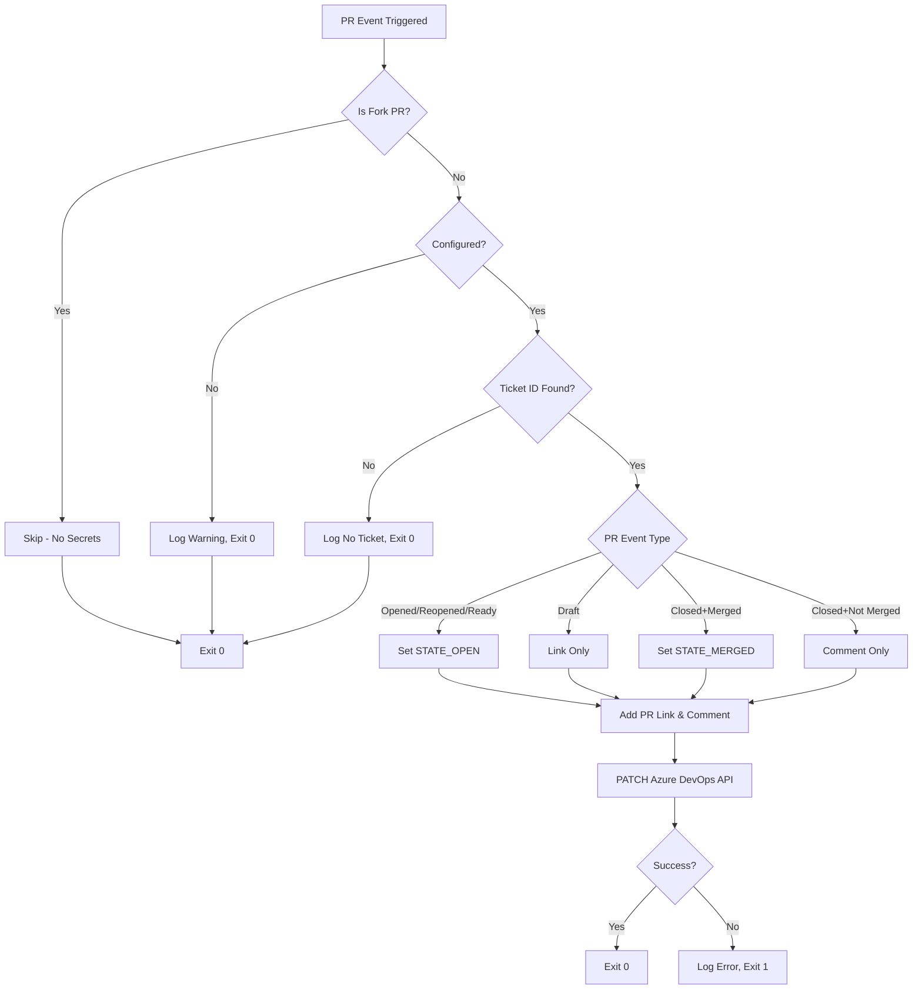

# PR Board Sync

Automatically sync GitHub pull requests to Azure Boards work items using GitHub Actions. When a PR is opened, marked ready, or merged, the linked Azure Boards work item (identified by `AB#123` or `AB-123` in the branch name, PR title, or body) is updated through the Azure DevOps REST API.

## What It Does

- **Extracts ticket IDs** from branch name, PR title, or PR body using the pattern `AB#123` or `AB-123`
- **Updates Azure Boards** work items based on PR events:
  - Open/reopened/ready_for_review → Sets state to `STATE_OPEN` (default: "Active")
  - Draft PR → Links PR without state change
  - Merged PR → Sets state to `STATE_MERGED` (default: "Closed")
  - Closed without merge → Adds comment, no state change
- **Adds PR links** as hyperlinks to the work item
- **Adds comments** to the work item history with PR details
- **Validates ticket IDs** via a required check on all PRs

## Flow Diagram

## Quick Start

### 1. Create the Repository

Push this code to a new GitHub repository. **Important:** The workflows must be on the main branch to trigger on PRs.

### 2. Add Azure Configuration (Optional)

Without configuration, the sync job runs but logs a warning and exits gracefully. To enable actual syncing:

- Go to repository **Settings** → **Secrets and variables** → **Actions**
- Add these **variables**:
  - `AZURE_ORG`: Your Azure DevOps organization name
  - `AZURE_PROJECT`: Your Azure DevOps project name
  - `AZURE_BASE_URL`: (Optional) Default is `https://dev.azure.com`
  - `STATE_OPEN`: (Optional) Default is `"Active"`
  - `STATE_MERGED`: (Optional) Default is `"Closed"`
- Add this **secret**:
  - `AZURE_DEVOPS_PAT`: Personal Access Token with Work Items (Read & write) scope

### 3. Enable Required Check

- Go to repository **Settings** → **Branches** → **Branch protection rules**
- Add a rule for your main branch
- Under "Require status checks to pass before merging", check `require-ticket-id`
- Save the rule

### 4. Create a PR

- Create a branch with a ticket ID: `feature/AB#123-fix`
- Or include the ticket in the PR title: `Fix bug AB#123`
- Or in the PR body: `Ticket: AB#123`
- The `require-ticket-id` check will fail if no ticket ID is found
- Once Azure credentials are added, the sync job will update the work item

## Behavior Before and After Adding Credentials

### Before Adding Credentials

- PR checks run and validate ticket IDs
- Sync job runs but logs: `::warning::Azure Boards not configured, skipping`
- Job exits with code 0 (green checkmark)
- No API calls to Azure DevOps

### After Adding Credentials

- PR checks still validate ticket IDs
- Sync job makes real API calls to Azure DevOps
- Work items are updated with state changes, PR links, and comments
- Job fails (red X) only on API errors (401, 403, 400, etc.)

## State Mapping Summary

| PR Event | Condition | Azure Boards State |
|----------|-----------|---------------------|
| Opened/Reopened/Ready | Not draft | `STATE_OPEN` (default: "Active") |
| Opened/Reopened | Draft | No state change |
| Closed | Merged | `STATE_MERGED` (default: "Closed") |
| Closed | Not merged | No state change |

Customize via `STATE_OPEN` and `STATE_MERGED` variables. See [docs/state-mapping.md](docs/state-mapping.md) for details.

## Documentation

- [Architecture](docs/architecture.md) - Sequence diagram and design decisions
- [GitHub Setup](docs/setup-github.md) - Detailed GitHub repository and workflow setup
- [Azure Boards Setup](docs/setup-azure-boards.md) - PAT creation and state name verification
- [State Mapping](docs/state-mapping.md) - Event-to-state mapping table
- [Testing](docs/testing.md) - Test matrix and how to run tests
- [Troubleshooting](docs/troubleshooting.md) - Common errors and solutions

## Next Steps

Once the integration is working, consider:

- **Reusable workflow**: Convert to a reusable GitHub Actions workflow for use across multiple repositories
- **Additional integrations**: Extend to sync from other systems (e.g., Jira, Linear)
- **Custom workflows**: Integrate with automated schema generation or CI/CD pipelines

## Tech Stack

- Node.js 20
- Zero dependencies (built-in `fetch`, `node:test`)
- GitHub Actions
- Azure DevOps REST API

## License

MIT
# Final test
