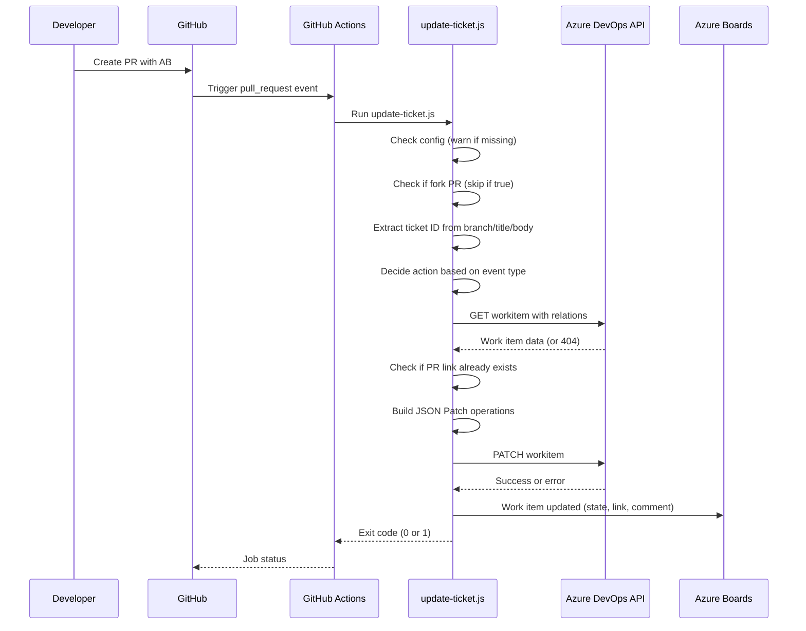

# Architecture

## Sequence Diagram



## Design Decisions

### Script-Based Implementation

The sync logic is implemented as a Node.js script (`.github/scripts/update-ticket.js`) rather than a composite action or GitHub Action. This choice provides:

- **Full testability**: Unit tests can mock fetch and validate all logic paths
- **No dependency on third-party actions**: Uses only built-in Node.js modules
- **Easy debugging**: Can run locally with test event payloads
- **Explicit error handling**: Full control over exit codes and logging

### Environment-Only Configuration

All configuration is via environment variables, with no hardcoded values:

- **Graceful degradation**: If config is missing, the script logs a warning and exits 0
- **Security**: Secrets are never logged or interpolated into commands
- **Flexibility**: Easy to change state names, URLs, etc. without code changes
- **CI/CD friendly**: Works the same in local dev and GitHub Actions

### No `pull_request_target` Trigger

The workflow uses `pull_request` trigger, not `pull_request_target`:

- **Security**: Fork PRs cannot access secrets (by design)
- **Explicit fork handling**: Script checks `event.pull_request.head.repo.fork` and skips
- **Principle of least privilege**: Only repo secrets are needed, not org secrets

### Graceful Skip When Unconfigured

The script is designed to work before credentials are added:

- **Early validation**: Config check happens before any API calls
- **Warning annotation**: Uses `::warning::` for GitHub UI visibility
- **Exit code 0**: Does not fail the PR when unconfigured
- **No code changes needed**: Adding credentials enables functionality immediately

### Concurrency Control

The workflow uses concurrency groups:

```yaml
concurrency:
  group: ticket-${{ github.event.pull_request.number }}
  cancel-in-progress: false
```

- **Per-PR grouping**: Multiple events for the same PR run sequentially
- **No cancellation**: `cancel-in-progress: false` ensures all updates complete
- **Race condition prevention**: Prevents simultaneous PATCH operations

### Retry Logic

The script implements a simple retry mechanism:

- **429 (rate limit)** and **5xx errors** trigger a retry after 2 seconds
- **Single retry**: Only one retry attempt to avoid infinite loops
- **Best effort**: Some transient errors may still fail, but common issues are handled

### Link Deduplication

Before adding a PR hyperlink, the script checks existing relations:

- **GET with `$expand=relations`**: Retrieves all work item relations
- **Hyperlink check**: Looks for existing link with the same URL
- **Skip if exists**: Avoids duplicate links in the work item

### HTML Escaping

Comments added to work items are HTML-escaped:

- **Security**: Prevents XSS in Azure Boards HTML rendering
- **Proper formatting**: Links are rendered as clickable hyperlinks
- **Consistency**: Matches Azure DevOps API expectations
